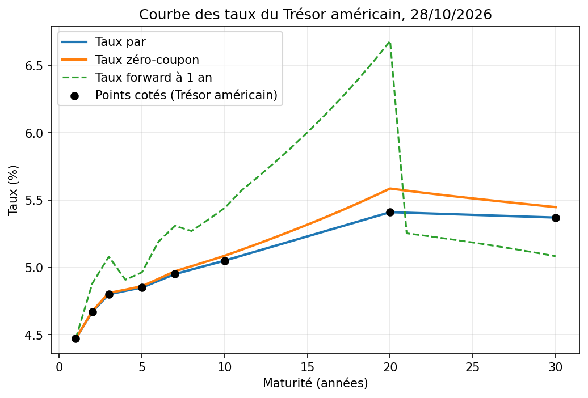

# Courbe des taux et obligations — prix, duration, bootstrapping, couverture

Prix d'une obligation, duration et convexité, construction de la courbe zéro-coupon par bootstrapping sur des taux réels du Trésor américain, et couverture d'un portefeuille obligataire testée sous plusieurs déformations de la courbe.

## Le projet

Le prix d'une obligation dépend des taux. La gestion du risque de taux repose sur trois questions : de combien le prix bouge-t-il quand les taux bougent, comment obtient-on la courbe des taux elle-même, et comment se couvre-t-on ? Ce projet y répond en six étapes, en Python et sans librairie de pricing : prix et rendement actuariel, duration et convexité, qualité de l'approximation, courbe zéro-coupon par bootstrapping, couverture par la duration et comparaison de trois couvertures.

L'obligation de référence est un nominal de 100, coupon annuel 4 %, maturité 5 ans, actualisé à 3 %. La courbe de marché est celle du Trésor américain au 28 octobre 2026. Le portefeuille couvert est fictif : 50 millions de nominal à 5 ans (coupon 4 %) et 30 millions à 10 ans (coupon 5 %), soit 78 032 899.

## Résultats clés

| | Valeur |
|---|---|
| Prix de l'obligation de référence (à 3 %) | 104,5797 |
| Prix au pair (taux = coupon, 4 %) | 100,0000 |
| Rendement actuariel d'une obligation cotée 95 | 5,16 % |
| Duration de Macaulay / modifiée | 4,6393 / 4,5042 |
| Convexité | 25,5680 |
| Prix sur la courbe zéro / avec le taux par à 5 ans | 96,2981 / 96,3046 |

| Choc (P&L total de la position couverte) | A : 30 ans | B : 7 ans | C : 2 ans + 10 ans |
|---|---|---|---|
| Parallèle +100 pb | −300 610 | 9 410 | 461 |
| Parallèle −100 pb | −380 880 | 11 238 | −396 |
| Parallèle +300 pb | −2 173 127 | 71 056 | 10 361 |
| Pentification | 2 383 488 | −76 628 | 2 118 |
| Aplatissement | −2 545 202 | 73 058 | 2 151 |
| Courbure | 1 066 734 | 71 501 | 129 349 |
| Nominal vendu | 35,9 millions | 76,4 millions | 68,7 + 41,0 millions |

**Le prix baisse quand les taux montent, de façon asymétrique.** De 3 % à 4 %, le prix baisse de 4,58 ; de 4 % à 5 %, de 4,33. Cette courbure est la convexité.

**La duration seule sous-estime toujours le prix.** Elle est précise pour un petit choc (erreur de 0,03 % à ±50 pb) mais s'écarte beaucoup pour une obligation longue : à 30 ans et +200 pb, elle annonce 75,33 pour un prix exact de 84,63 (−10,98 %), contre 86,44 (+2,14 %) avec la convexité.

**La courbe zéro n'est pas la courbe par.** À 10 ans, le taux zéro est de 5,086 % pour un taux par de 5,05 % ; le taux forward de la 20e année atteint 6,68 %. Le bootstrapping reprice exactement les obligations au pair (100,000000 de 1 à 30 ans).

**Un DV01 nul ne signifie pas un risque nul.** La couverture à 30 ans annule le mouvement parallèle (DV01 total de −34 pour un point de base) mais laisse 2,4 à 2,5 millions de perte pour une déformation de pente de ±50 pb, soit 3 % de la valeur. Le portefeuille est exposé aux tranches de 4 à 12 ans et la couverture à la tranche de 13 à 30 ans. Le total est aussi vendeur de convexité : il perd dans les deux sens du mouvement parallèle (−0,39 % et −0,49 %).

**Le bon instrument vaut mieux que plus d'instruments.** Une obligation à 7 ans ramène l'erreur à moins de 0,1 % pour tous les chocs. Le couple 2 ans / 10 ans annule le niveau et la pente par construction mais laisse 0,166 % d'erreur de courbure, au prix de 110 millions de nominal vendu.

## Graphiques

## Fichiers

| Fichier | Description |
|---|---|
| `Courbe_Taux_Obligations.ipynb` | Notebook Python complet, avec explications, contrôles automatiques et export des résultats |
| `Courbe_Taux_Dossier.pdf` / `.docx` | Dossier méthodologique de 6 pages : méthode, résultats, limites |
| `duration_convexite.png`, `courbe_taux.png`, `couverture_duration.png`, `comparaison_couvertures.png` | Graphiques générés par le notebook |
| `prix_selon_taux.csv`, `duration_convexite.csv`, `approximations_prix.csv`, `courbe_taux.csv`, `chocs_couverture_30ans.csv`, `dv01_par_tranche.csv`, `comparaison_couvertures.csv` | Résultats numériques exportés par la dernière cellule |

## Outils

Python (numpy, pandas, scipy, matplotlib), notebook Google Colab.

## Limites et pistes d'amélioration

- Coupons annuels, alors que les obligations du Trésor américain en paient deux par an.
- Interpolation linéaire des taux par entre huit points cotés ; les salles de marché utilisent des splines ou le modèle de Nelson-Siegel.
- Une seule date de courbe (28 octobre 2026) : l'évolution de la courbe n'est pas étudiée.
- Portefeuille fictif, couverture statique, ni coûts de transaction, ni risque de crédit ou de liquidité.
- Chocs de courbe stylisés ; une analyse en composantes principales des mouvements historiques donnerait des chocs réalistes.
- Piste : couvrir avec des contrats à terme sur obligations et mesurer systématiquement le DV01 par tranche (key rate duration).

---
*Projet réalisé dans le cadre d'une recherche de stage/alternance en finance de marché (trading, taux, risque).*
